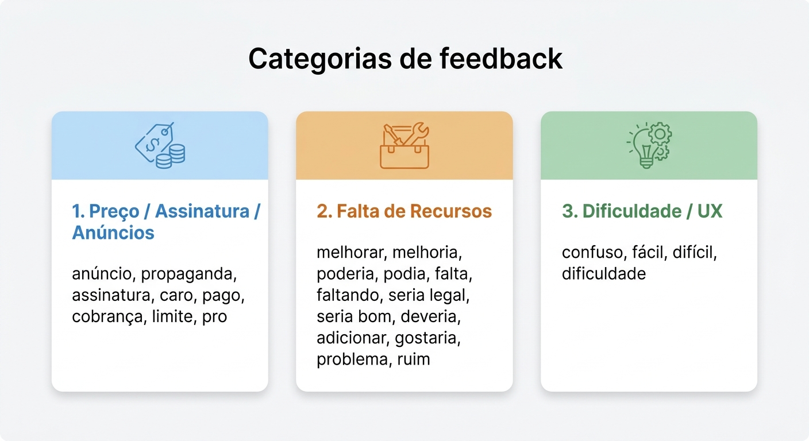
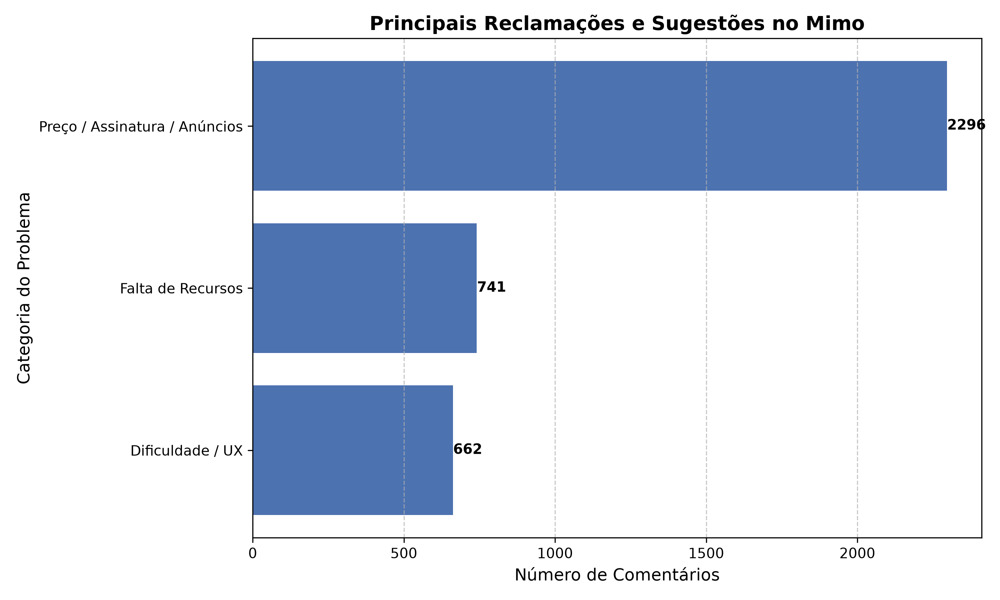
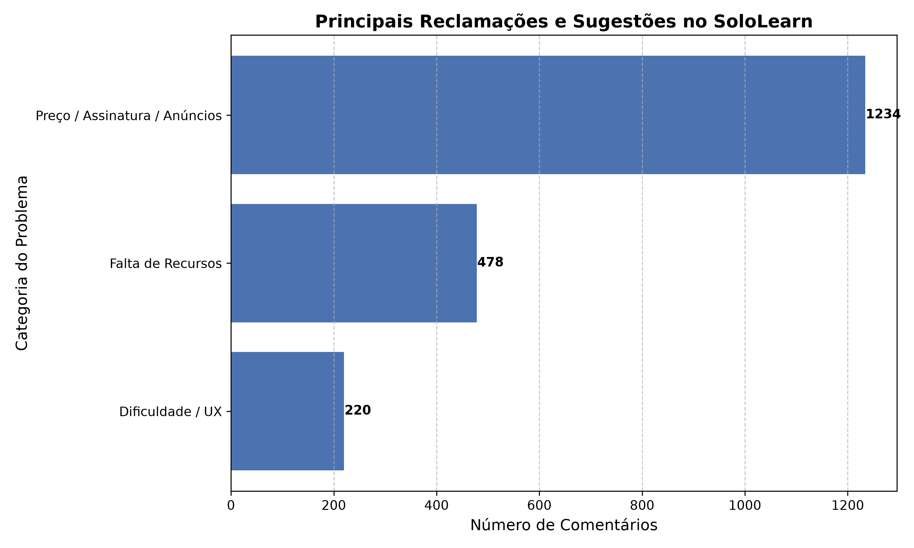
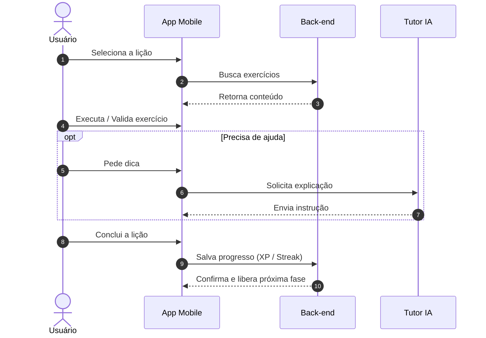
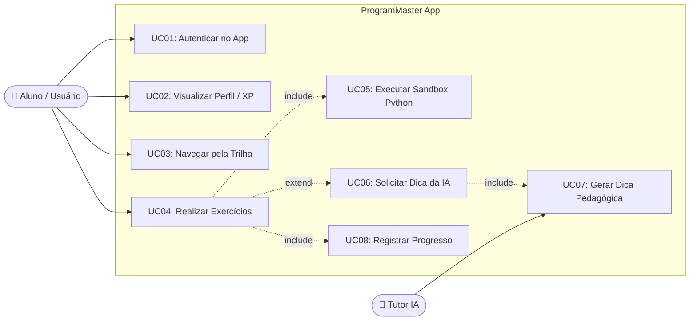

# 🚀 ProgramMaster — Plataforma de Aprendizagem em Programação

## 📖 Sobre o Projeto

Este projeto tem como objetivo desenvolver uma **plataforma interativa de aprendizagem de programação**, criada para auxiliar principalmente pessoas que estão iniciando sua jornada no desenvolvimento de software.

A plataforma busca transformar o aprendizado de programação em uma experiência mais **dinâmica, prática e envolvente**, combinando conteúdos educacionais, exercícios e elementos de gamificação.

---

## 🎯 Objetivo

O principal objetivo do projeto é **facilitar o aprendizado de programação para iniciantes**, proporcionando uma experiência que estimule a prática constante e mantenha o usuário motivado durante sua evolução.

A plataforma pretende:

* 🧑‍💻 Auxiliar pessoas que estão começando a programar;
* 📚 Apresentar conteúdos de forma progressiva;
* 🧩 Propor exercícios e desafios práticos;
* 📈 Permitir que o usuário acompanhe sua evolução;
* 🔥 Estimular a criação de uma rotina de estudos;
* 🏆 Criar metas, conquistas e recompensas;
* ⚡ Tornar o processo de aprendizagem mais dinâmico;

---

## 📊 Pesquisa e Validação (Data-Driven)

Esta seção resume a pesquisa de mercado e o feedback dos usuários reais coletados na Google Play Store (amostra de 3.094 avaliações, filtradas de 10.000 avaliações relacionadas ao aplicativo MIMO; amostra de 1701 avaliações, filtradas de 6690 avaliações relacionadas ao aplicativo Sololearn).

### Palavras Chave

## Resultado Mimo

### Pontos Positivos
- A Curva de Aprendizado e a Didática.
- Praticidade e Foco.
- Engajamento Inicial.

### Pontos Negativos
- O Sistema de "Chaves" (Paywall Agressivo).
- Falta de Profundidade / Prática Real.

### Sugestões para Além da Pesquisa

 **1. Boas Características para se Inspirar em**
- Playground Integrado Móvel.
- Micro-learning (Aulas em Pedaços).

 **2. Problemas Críticos a Evitar**
- Sensação de "Ilusão de Competência".
- Falta de Feedback nos Erros.
- Dependência Excessiva de Conexão Continuada.

 **3. Sugestões Práticas para o Projeto Integrador**
- Editor com Digitação Guiada e Teclado Facilitado.
- Explicação Educativa de Bugs.
- Modo Offline para Exercícios.

**Link para a pesquisa:**
https://github.com/1Soryuu/ProgramMaster/blob/main/Pesquisa/Mimo/scrape_mimo_10000.csv

## Resultado Sololearn

### Pontos Positivos
- Comunidade e Fóruns.
- Curva de Aprendizado Inicial.

### Pontos Negativos
- O Bloqueio do Próprio Código e Ferramentas de IA (Prática Paga).

### Sugestões para Além da Pesquisa

 **1. Problemas de UX para Evitar**
- Excesso de Poluição Visual (Feature Creep).

 **2. Sugestões Práticas para o Projeto Integrador**
- Feedback de Erro Construtivo.

**Link para a pesquisa:**
https://github.com/1Soryuu/ProgramMaster/blob/main/Pesquisa/SoloLearn/scrape_solo_learn_10000.csv

---

## ⚙️ Funcionalidades Principais

### 1. Autenticação e Perfil do Usuário
- **Autenticação Simplificada:** Cadastro e login rápido via OAuth (Google, Apple, etc.), liberado de forma fluida para que o usuário experimente o valor do aplicativo sem barreiras iniciais.
- **Perfil de Usuário:** Armazenamento centralizado do progresso individual e das estatísticas de estudo.

### 2. Arquitetura Modular e Progressão por Níveis
- **Grade de Módulos (Grid):** Organização visual limpa em formato de "página de livro", cobrindo a jornada essencial de Python.
- **Três Níveis de Dificuldade:** Conteúdo estruturado em camadas progressivas (**Básico, Intermediário e Avançado**), permitindo uma curva de aprendizado gradual e adaptada a diferentes perfis de alunos.
- **Lições em Pílulas (Cards):** Explicações teóricas curtas, objetivas e diretas ao ponto, divididas em micro-etapas de fácil assimilação.

### 3. Motor de Lições e Arcade de Prática
- **Formatos Diversificados de Exercícios:**
  * Múltipla escolha e análise de saída (*output*).
  * Ordenação de blocos de lógica e sintaxe.
  * Preenchimento de lacunas (*fill-in-the-blank*).
  * **Escrita de Código:** Terminal ou editor integrado para digitação real de sintaxe, superando métodos puramente passivos.
- **Arcade de Prática:** Área dedicada para fixação e desafios livres.
- **Feedback Imediato:** Retorno instantâneo de acerto ou erro com explicações claras sobre a lógica envolvida.

### 4. Tutor de Inteligência Artificial (Suporte em PT-BR)
- **Assistente Pedagógico Contextual:** Analisa os erros de sintaxe e lógica do aluno durante os exercícios, oferecendo orientações personalizadas em **português** que explicam o *porquê* do problema, sem entregar a resposta pronta.
- **Feedback Preventivo:** Identifica padrões recorrentes de dúvida e sugere dicas rápidas antes que o aluno fique travado em um desafio.

### 5. Mecânica de Retenção e Gamificação Positiva
- **Contador de Ofensiva (Streak):** Monitoramento de dias consecutivos de estudo com foco em construção de hábito sustentável.
- **Progresso Visual:** Barras de conclusão claras por módulo, indicadores de nível de domínio e recompensas visuais ao finalizar cada etapa.

---

## Diagramas de sequência e de caso de uso

---

## 🎨 Diretrizes de UI/UX e Gamificação (Data-Driven Design)

As decisões de interface e experiência do usuário deste projeto foram validadas por meio da análise quantitativa de avaliações de usuários coletadas via web scraping de plataformas concorrentes, atacando diretamente os principais pontos de frustração identificados: *barreira de pagamento (chaves/vidas)*, *falta de profundidade* e *falta de recursos práticos*.

### 1. Arquitetura de Informação e Interface (UI)
- **Trilha em Grid ("Página de Livro"):** Organização dos módulos em uma matriz limpa de **linhas x colunas**, otimizando a densidade visual e a navegação mobile.
- **Protagonismo do Código:** Nas telas de exercícios, o editor e a lógica de programação ocupam o foco central, enquanto instruções e botões secundários são hierarquizados por contraste e peso visual.
- **Minimalismo Funcional:** Design limpo e livre de poluição visual para reduzir a carga cognitiva e o cansaso mental.
- **Feedback Instantâneo:** Respostas visuais imediatas e claras para cada interação (validações de erro, acertos e estados de carregamento), evitando a perda de progresso reportada em apps concorrentes.

### 2. Experiência do Usuário (UX) e Gamificação
- **Aprendizado Contínuo:** Diferente de modelos punitivos que limitam o estudo diário a poucas lições gratuitas, a gamificação aqui foca em **constância e recompensa**, permitindo que o aluno pratique no seu próprio ritmo sem interrupções forçadas.
- **Onboarding sem Atrito:** Acesso imediato à prática de código antes de exigir cadastros complexos, reduzindo a taxa de abandono inicial.
- **Microlearning e Estado de Fluxo (Flow):** Conteúdo dividido em blocos curtos e cumulativos, equilibrando teoria direta ao ponto com desafios progressivos para evitar tanto o tédio quanto a frustração de iniciantes.
- **Prática Ativa e Arcade:** Além das lições guiadas, a UX contempla um ambiente dedicado a exercícios baseados no código dos usuários, para solucionar o problema da repetitividade.
- **Níveis de Dificuldade:** Estruturação dos módulos de forma a acomodar diferentes perfis de alunos — desde o nível básico até o avançado —, permitindo uma transição fluida sem causar frustração por saltos bruscos de complexidade.

A intenção é criar um ambiente no qual o usuário consiga **visualizar sua evolução e estabelecer objetivos**, tornando o aprendizado mais estimulante.

**Link para o protótipo de UI:**
https://www.figma.com/make/wBkfmdTiRhOMTxAFXoXtfz/Prot%C3%B3tipo-ProgramMaster?fullscreen=1&t=NdbmsVuGIXVlrzQX-1&code-node-id=0-6

---

## 📚 Estrutura de Aprendizagem

O conteúdo será organizado de maneira progressiva, começando pelos conceitos fundamentais e avançando gradualmente para assuntos mais complexos.

### 🟢 Nível Iniciante

* Variáveis;
* Tipos de dados;
* Operadores;
* Condicionais;
* Estruturas de repetição;
* Funções.

### 🟡 Nível Intermediário

* Estruturas de dados (Listas, Tuplas, Dicionários e Conjuntos);
* Manipulação de arquivos;
* * Tratamento de erros;
* Programação orientada a objetos;
* Modularização;
* Bibliotecas.

### 🔴 Nível Avançado

* Estruturas de dados avançadas;
* Arquitetura de software;
* Padrões de projeto;
* APIs;
* Banco de dados;
* Desenvolvimento de projetos.

---

## 🛠️ Tecnologias

### **Front-end & Mobile**

**React Native + Expo:** Simplificam a navegação além de permitirem a reutilização do código Web no mobile.

**JS / TS + React:** Transição suave do React (Web) para o React Native. TypeScript ajuda a evitar erros comuns de digitação em estruturas JSON.

### **Back-end & Infraestrutura**

**Pyodide + WebAssembly:** Pyodide permite executar o código Python diretamente no dispositivo do usuário via WebAssembly. Isso reduz o custo de servidor a quase zero e elimina riscos de segurança no Back-end.

**Node.js:** Orquestra as APIs REST de navegação, entrega as lições e chamadas para a LLM (Tutor IA).

**PostgreSQL:** Banco relacional sólido para salvar o progresso das lições, e as ofensivas (streaks).

---

## 🗓️ Roadmap do MVP

- [ ] **Milestone 1: Alinhamento, Design e Base do Projeto**  
  * Protótipo no Figma, setup da estrutura Expo/Node.js, modelagem do PostgreSQL e criação do conteúdo inicial.
- [ ] **Milestone 2: Núcleo do Aplicativo**  
  * Login com Firebase, mapa de fases e motor visual dos 3 tipos de exercícios.
- [ ] **Milestone 3: Gamificação e Sandbox Python**  
  * Contador de Streaks, barra de progresso e integração do Pyodide (WASM) para execução de código.
- [ ] **Milestone 4: Tutor IA**  
  * Engenharia de prompts e integração da LLM para suporte dinâmico no player de exercícios.
- [ ] **Milestone 5: Testes e Lançamento**  
  * Correções de bugs, polimento de UI/UX, deploy da infraestrutura e publicação da versão de teste.
  
---

## 👥 Equipe

| Integrante                       | Função    |
| -------------------------------- | --------- |
| Victor Yamada Miyashiro          | Frontend  |
| Guilherme Gotardo Santana        | Backend   |
| Pedro Vieira Lima                | UI/UX     |
| Matheus Vinicius da Silva Marigo | Backend   |
| João Vitor Maia                  | Conteúdo  |
| Bruno Henrique Viana de Souza    | Backend   |
